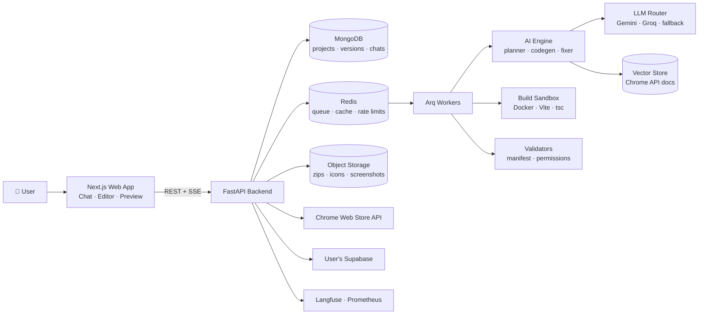
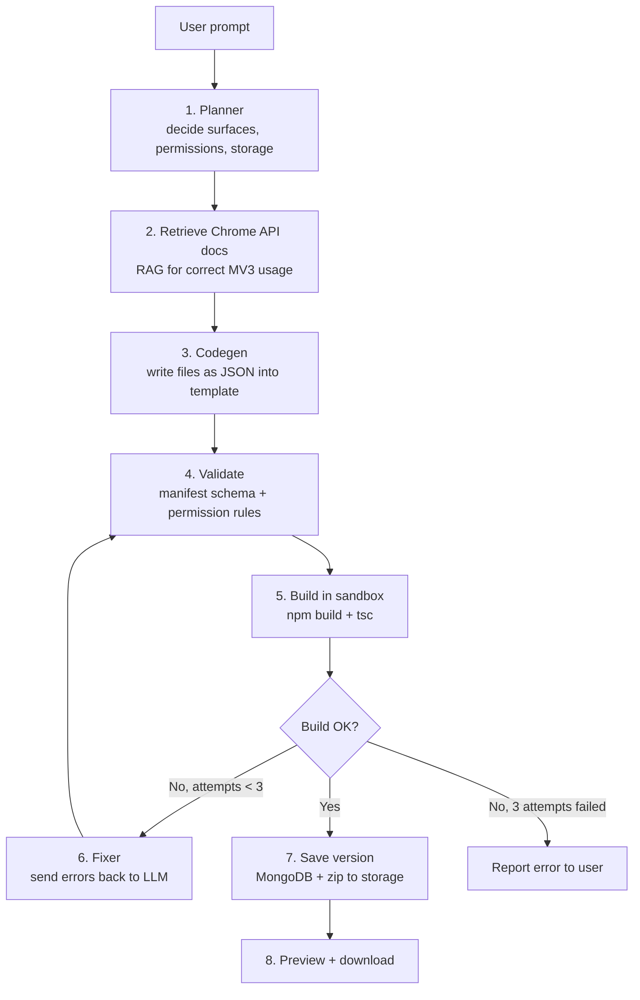
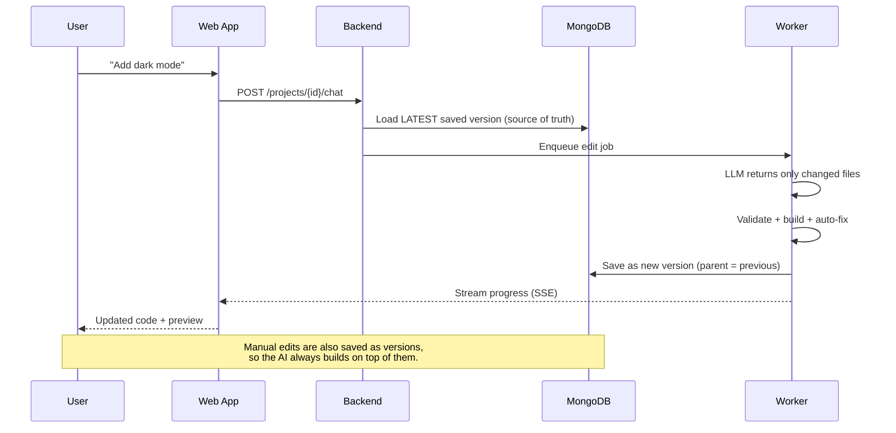
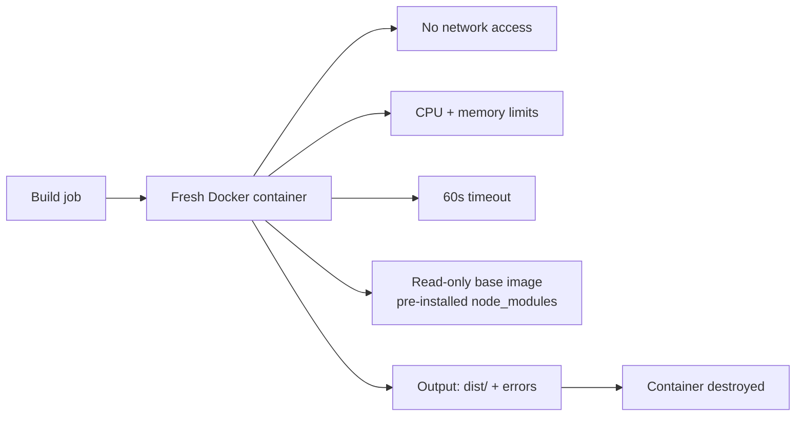
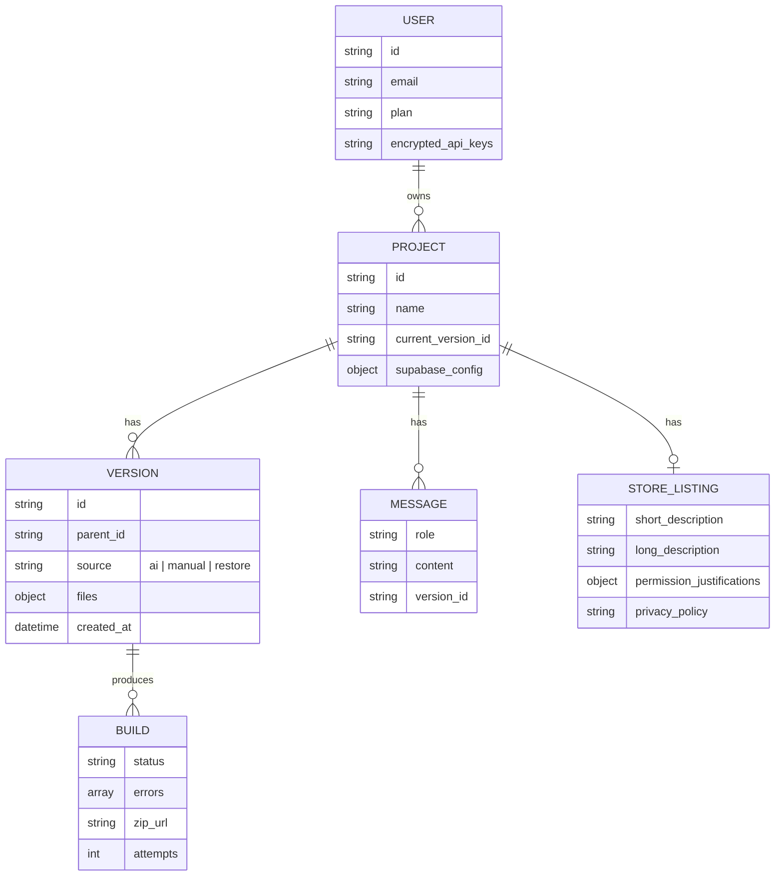

# lovablish-AI-Chrome-Extension-Builder


> **Describe a Chrome extension in plain English. Get a working, installable Manifest V3 extension in minutes.**

Lovablish is an AI-powered Chrome extension builder — "Lovable, but for Chrome extensions". You type an idea like *"Summarize the article I'm reading and let me ask questions about it"*, and Lovablish generates the full extension (manifest, popup, content scripts, background service worker), verifies it builds, lets you refine it by chatting, and packages it for the Chrome Web Store.

---

## Why Lovablish?

General AI app builders (Lovable, Bolt, v0) are built for **web apps**. Chrome extensions have a completely different architecture:

| Web app | Chrome extension |
|---|---|
| One page, one runtime | Popup, content scripts, service worker, options page — separate runtimes |
| State lives in memory | Service worker sleeps — state must live in `chrome.storage` |
| No permissions model | `manifest.json` permissions, host permissions, CSP |
| Preview in an iframe | Must be loaded into Chrome to run for real |
| Deploy to a URL | Submit to Chrome Web Store with justifications & privacy disclosures |

Generic LLMs often hallucinate manifest keys, use outdated Manifest V2 APIs, or request excessive permissions — the #1 reason extensions get rejected. Lovablish is purpose-built for this one ecosystem.

---

## Features

### Core
- **Prompt → working extension** — full Manifest V3 package in React + TypeScript + Tailwind
- **Build verification + auto-fix loop** — every generation is compiled; errors are fed back to the AI until it builds (max 3 attempts)
- **Chat refinement** — "add dark mode", "only run on LinkedIn", "add a keyboard shortcut"
- **Code editor** — edit files by hand; chat and manual edits stay in sync
- **Version history** — every change (AI or manual) is a version you can restore
- **Live preview** — popup, side panel, options and new-tab pages rendered with mocked `chrome.*` APIs
- **One-click download** — zip ready for `chrome://extensions` → *Load unpacked*

### Full-stack & AI
- **Supabase integration** — auth, database CRUD, session persisted in `chrome.storage`, automatic token refresh
- **BYOK AI features** — extensions can call OpenAI / Gemini / Groq using the user's own key

### Shipping
- **Least-privilege permissions** — permissions added only when a feature needs them
- **Dead-permission scanner** — static analysis flags declared permissions the code never uses
- **Store kit** — listing copy, short description, single-purpose statement, permission justifications, privacy policy, icons and screenshots
- **Publish to Chrome Web Store** — OAuth connection, upload and publish from the app

---

## System Architecture

### High-level overview



**How to read it:** the web app only talks to the FastAPI backend. Anything slow (generating code, building, validating) is pushed onto a Redis queue and handled by background workers, so the API stays fast and the user sees live progress via Server-Sent Events.

---

### Generation pipeline (prompt → extension)



**Key design choices**
- The AI **never writes build config**. Every extension starts from a fixed, tested Vite + CRXJS template; the model only writes feature code. This removes a whole class of failures.
- Output is **structured JSON** (`{path, content}` per file), validated with Pydantic before anything touches the file system.
- The **planner** runs first so permissions are decided from features, not guessed.

---

### Chat refinement & version sync



**Why the database is the source of truth:** if the AI edited a stale copy held in the browser (e.g. after an undo), it would silently overwrite the user's manual changes. Every edit — AI or human — reads from and writes to the latest saved version.

---

### Build sandbox (running untrusted code safely)



AI-generated code is untrusted. Each build runs in a throwaway container with no network, strict resource limits and a timeout. Dependencies are pre-installed in the base image so builds are fast (~5–10s).

---

### Permission scanner

```mermaid
flowchart LR
    A[Generated code] --> B[Parse to AST<br/>ts-morph]
    B --> C[Find chrome.* API calls<br/>dot + bracket literals]
    C --> D{Compare with manifest}
    D -->|Declared + used| E[✅ Keep]
    D -->|Declared + never used| F[⚠️ Suggest removal]
    D -->|Dynamic chrome[var] access| G[🔍 Can't tell — flag for manual review]
```

Bias is deliberately conservative: a false "keep" is harmless, a false "remove" breaks a working extension.

---

### Data model



---

## Tech Stack

| Layer | Technology | Why |
|---|---|---|
| **Frontend** | Next.js, TypeScript, Tailwind CSS, shadcn/ui | Fast to build, great DX |
| **Code editor** | Monaco Editor | Same editor as VS Code |
| **Preview** | Sandboxed iframe + mocked `chrome.*` APIs | Render popup/options UI in the browser |
| **Backend API** | FastAPI (Python) | Async, typed, fast |
| **Streaming** | Server-Sent Events | Live generation progress |
| **Job queue + scheduler** | Redis + Arq | Async workers, retries, timeouts, cron |
| **Database** | MongoDB | Flexible documents for files & versions |
| **Vector store** | MongoDB Atlas Vector Search (or Qdrant) | RAG over Chrome extension docs |
| **Object storage** | Cloudflare R2 / S3-compatible | Zips, icons, screenshots |
| **Build sandbox** | Docker, Node.js, Vite + CRXJS, TypeScript | Isolated, reproducible builds |
| **Static analysis** | ts-morph | Permission usage scanning |
| **LLMs** | Gemini (primary), Groq (fast fixes), fallback router | Free tiers for development |
| **Structured output** | Pydantic + JSON schema | Reliable file output from the LLM |
| **Auth** | Auth.js (Google / GitHub) | Simple OAuth login |
| **Integrations** | Supabase, Chrome Web Store API | Full-stack extensions + publishing |
| **Observability** | Langfuse (LLM traces), Prometheus + Grafana, Sentry | Cost, latency, errors |
| **Deployment** | Vercel (frontend), Docker Compose on a VM (API, workers, Redis) | Free / low cost |
| **CI** | GitHub Actions | Tests + evals on every PR |

### Generated extension stack
Every extension Lovablish creates uses: **Manifest V3 · React · TypeScript · Tailwind · Vite + CRXJS**, with `chrome.storage.local` as the source of truth for state.

---

## Evaluation

Lovablish ships with an eval suite so quality is measured, not guessed.

| Metric | What it measures |
|---|---|
| **First-try build rate** | % of prompts that build without any fix |
| **Final build rate** | % that build after the auto-fix loop |
| **Avg fix attempts** | How hard the fixer has to work |
| **Permission precision** | % of declared permissions actually used |
| **Generation latency** | p50 / p95 time from prompt to built zip |
| **Cost per generation** | Tokens × price, tracked per model |

Run with:
```bash
make eval            # runs 50 benchmark prompts across all models
```

---

## Project Structure

```
lovablish/
├── apps/
│   ├── web/                    # Next.js frontend
│   │   ├── app/                # routes: /, /project/[id]
│   │   ├── components/         # chat, editor, preview, file tree
│   │   └── lib/chrome-mock/    # mocked chrome.* APIs for preview
│   └── api/                    # FastAPI backend
│       ├── routes/             # projects, chat, builds, publish
│       ├── ai/
│       │   ├── planner.py
│       │   ├── codegen.py
│       │   ├── fixer.py
│       │   ├── store_kit.py
│       │   ├── router.py       # LLM provider routing + fallback
│       │   └── prompts/
│       ├── rag/                # Chrome docs ingestion + retrieval
│       ├── validators/         # manifest schema, permission rules
│       ├── workers/            # Arq jobs: generate, build, publish
│       └── models/             # Pydantic + DB models
├── sandbox/
│   ├── Dockerfile              # Node + pre-installed deps
│   ├── template/               # Vite + CRXJS + React + TS starter
│   └── scanner/                # ts-morph permission scanner
├── evals/
│   ├── prompts.jsonl           # benchmark prompts
│   └── run_evals.py
├── infra/
│   ├── docker-compose.yml
│   └── grafana/
└── README.md
```

---

## API Overview

| Method | Endpoint | Description |
|---|---|---|
| `POST` | `/projects` | Create project from a prompt |
| `GET` | `/projects/{id}` | Get project + latest version |
| `POST` | `/projects/{id}/chat` | Refine via chat |
| `PUT` | `/projects/{id}/files` | Save manual edits (new version) |
| `GET` | `/projects/{id}/versions` | List versions |
| `POST` | `/projects/{id}/versions/{vid}/restore` | Restore a version |
| `GET` | `/projects/{id}/events` | SSE stream of job progress |
| `GET` | `/projects/{id}/download` | Download zip |
| `POST` | `/projects/{id}/store-kit` | Generate listing, justifications, privacy policy |
| `POST` | `/projects/{id}/publish` | Publish to Chrome Web Store |

---

## Getting Started

```bash
git clone https://github.com/<you>/lovablish.git
cd lovablish
cp .env.example .env        # add GEMINI_API_KEY, GROQ_API_KEY, MONGODB_URI
docker compose up --build   # api, workers, redis, sandbox
cd apps/web && npm install && npm run dev
```

Open `http://localhost:3000`, describe an extension, then load the downloaded folder at `chrome://extensions` → **Developer mode** → **Load unpacked**.

---
## Security

- AI-generated code only runs inside isolated, network-less containers
- User API keys and OAuth tokens are encrypted at rest
- Generated extensions never use remote code execution (MV3 compliant)
- Per-user rate limits and fair-use caps on generations

---

## License

MIT
